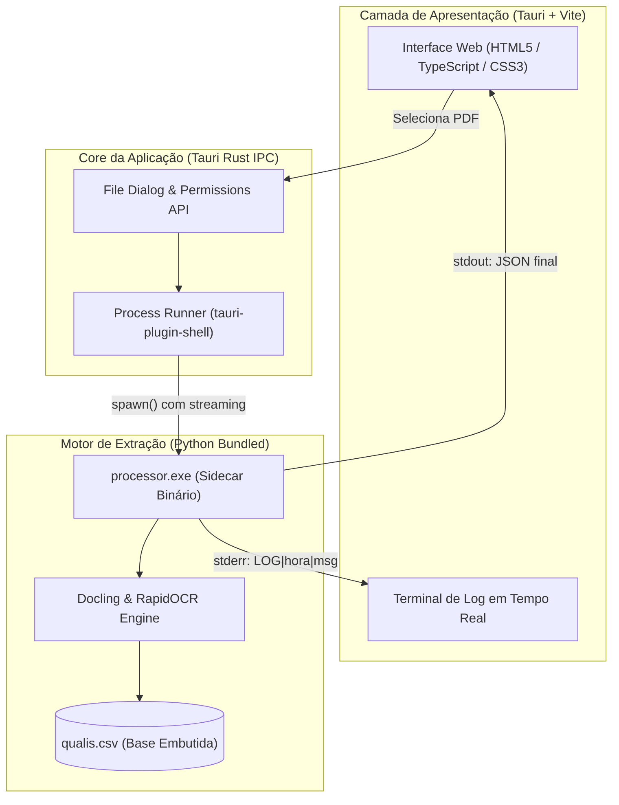

<div align="center">

# 🎓 AutoQualis

**Automação inteligente e offline para extração de ISSN e classificação Qualis/CAPES de artigos científicos.**

[](LICENSE)
[](https://tauri.app/)
[](https://github.com/DS4SD/docling)
[](https://www.rust-lang.org/)
[](https://www.typescriptlang.org/)
[](https://www.python.org/)

<p align="center">
  <a href="#-sobre-o-projeto">Sobre</a> •
  <a href="#-principais-recursos">Recursos</a> •
  <a href="#-arquitetura">Arquitetura</a> •
  <a href="#-tecnologias">Tecnologias</a> •
  <a href="#-como-executar">Como Executar</a> •
  <a href="#-roadmap">Roadmap</a> •
  <a href="#-licença">Licença</a>
</p>

</div>

---

## 📌 Sobre o Projeto

O **AutoQualis** é uma aplicação desktop desenvolvida para solucionar um gargalo comum na rotina acadêmica de pesquisadores, docentes e discentes de pós-graduação: a necessidade de verificar manualmente o estrato Qualis/CAPES de cada artigo científico submetido ou avaliado.

Combinando uma interface leve e reativa com um motor local de parsing baseado em visão computacional e inteligência artificial, o aplicativo extrai automaticamente o identificador de publicação (**ISSN**) contido no PDF e realiza o mapeamento instantâneo contra o banco de dados oficial do Qualis (Quadriênio 2017–2020), exibindo métricas, periódico e classificação por estrato (**A1 até C**).

---

## ⚡ Principais Recursos

- 🛡️ **Digital Bunker (100% Offline):** Todo o processamento OCR, extração de texto e consulta à base de dados ocorrem estritamente na máquina local. Nenhum dado ou PDF é transmitido para serviços em nuvem.
- 🧠 **Motor de IA Docling + RapidOCR:** Capacidade de parsing avançado de documentos científicos, identificando padrões de metadados mesmo em artigos escaneados, com colunas múltiplas ou layouts complexos.
- 📊 **Mapeamento Direto Qualis/CAPES:** Consulta instantânea integrada com a base oficial de Ciência da Computação (2.785+ periódicos classificados).
- 📟 **Terminal de Telemetria Integrado:** Painel retrátil no rodapé que transmite eventos do motor Python em tempo real (*streaming via stderr*), permitindo acompanhar o fluxo interno da extração passo a passo.
- 🎨 **Interface Moderna e Fluida:** Construída com foco em usabilidade, com badges dinâmicos de estratos codificados por cores (🟢 A1–A4, 🟡 B1–B2, 🟠 B3–B4, 🔴 C).

---

## 🏗️ Arquitetura do Sistema

O AutoQualis adota uma arquitetura híbrida com desacoplamento através de **Sidecar**:



---

## 🛠️ Tecnologias Utilizadas

| Camada | Tecnologia | Finalidade |
| :--- | :--- | :--- |
| **Shell / Desktop** | [Tauri v2](https://tauri.app/) (Rust) | Janela nativa, segurança, sandbox de arquivos e execução de sidecars |
| **Frontend** | [TypeScript](https://www.typescriptlang.org/) & [Vite](https://vitejs.dev/) | Lógica de renderização reativa e tipagem estática |
| **Estilo** | CSS3 Moderno (Custom Properties) | Tema dark minimalista, responsividade e badges dinâmicos |
| **Motor de Documentos** | [IBM Docling](https://github.com/DS4SD/docling) | Conversão de PDF em formato estruturado offline |
| **OCR & Visão** | [RapidOCR](https://github.com/RapidAI/RapidOCR) + PyTorch | Reconhecimento óptico de caracteres em documentos rasterizados |
| **Empacotador Sidecar** | [PyInstaller](https://pyinstaller.org/) | Compilação do motor Python em binário autônomo com metadados embutidos |
| **Runtime JS** | [Bun](https://bun.sh/) | Gerenciamento ultrarrápido de dependências e bundling |

---

## 🚀 Como Executar Localmente

### 📋 Pré-requisitos

Certifique-se de ter instalado em sua máquina:
- [Bun](https://bun.sh/) (ou Node.js 18+)
- [Rust & Cargo](https://rustup.rs/) (versão estável)
- [Python 3.11+](https://www.python.org/)

### 1. Clonar o Repositório

```bash
git clone https://github.com/EiRancor/AutoQualis.git
cd AutoQualis
```

### 2. Instalar Dependências do Frontend

```bash
bun install
```

### 3. Configurar e Compilar o Motor Python (Sidecar)

Crie o ambiente virtual e instale as dependências do motor:

```bash
cd python_motor
python -m venv venv

# Windows (PowerShell):
.\venv\Scripts\Activate.ps1

# Linux / macOS:
source venv/bin/activate

pip install -r requirements.txt  # ou: pip install docling pyinstaller openpyxl pandas
```

Gere o executável contendo a base do Qualis embutida:

```bash
pyinstaller processor.spec --noconfirm --clean
```

Copie o binário gerado para a pasta de binários do Tauri correspondente à sua arquitetura:

- **Windows (x86_64):**
  ```powershell
  Copy-Item dist\processor.exe ..\src-tauri\bin\processor-x86_64-pc-windows-msvc.exe
  ```
- **Linux (x86_64):**
  ```bash
  cp dist/processor ../src-tauri/bin/processor-x86_64-unknown-linux-gnu
  ```

Retorne à raiz do projeto:
```bash
cd ..
```

### 4. Executar em Modo de Desenvolvimento

```bash
bun tauri dev
```

---

## 📍 Roadmap de Evolução

- [x] Extração inteligente de ISSN com validação de falsos positivos.
- [x] Base de dados integrada offline para Ciência da Computação (2017–2020).
- [x] Streaming de logs em tempo real para o usuário (console interativo).
- [ ] **Múltiplas Áreas de Avaliação:** Suporte a seleção de outras áreas de conhecimento da CAPES (Medicina, Engenharias, Educação, etc.).
- [ ] **Processamento em Lote (Batch):** Capacidade de arrastar múltiplos arquivos ou diretórios inteiros com exportação em `.csv` ou `.xlsx`.
- [ ] **Comparação Histórica de Quadriênios:** Mapear a transição de estratos entre os ciclos (ex: 2013–2016 vs. 2017–2020).
- [ ] **Persistência Local (SQLite):** Histórico de artigos já avaliados para consulta instantânea sem reprocessamento.

---

## 📄 Licença

Distribuído sob a licença **GNU General Public License v3.0 (GPL-3.0)**. Consulte o arquivo [LICENSE](LICENSE) para obter mais informações.

---

<div align="center">
  <sub>Desenvolvido com foco em soberania de dados e eficiência acadêmica por <b>Emerson Rancor</b> • Ciência da Computação (UNEMAT).</sub>
</div>
